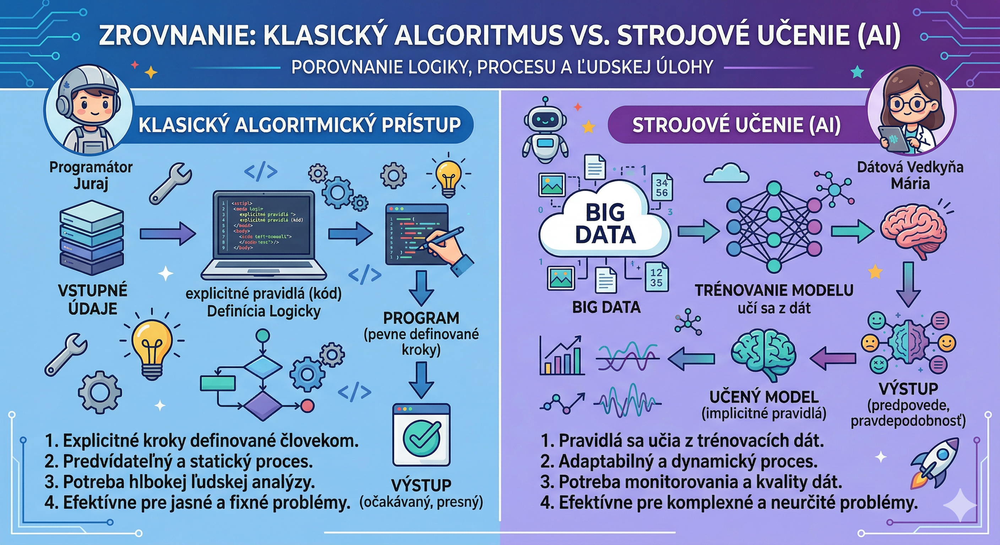
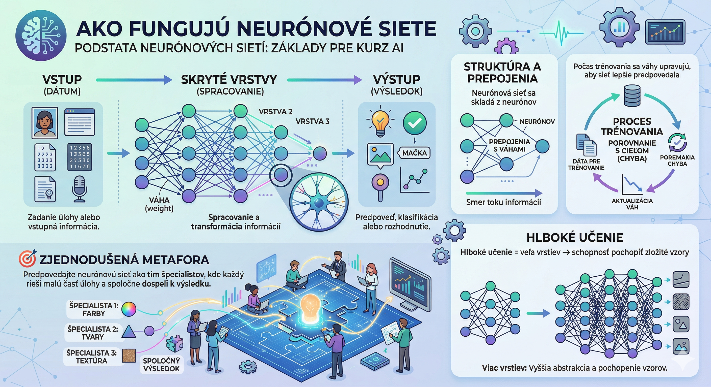
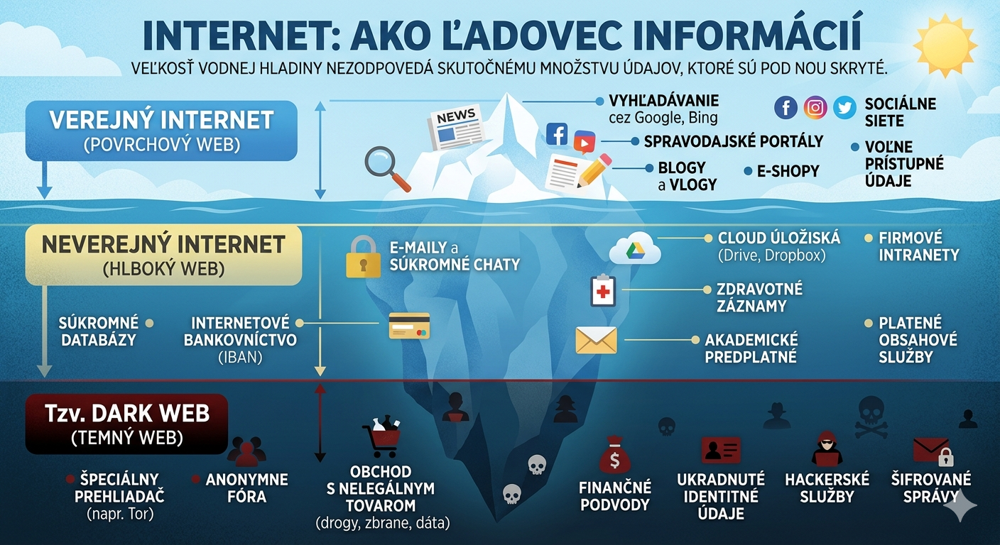
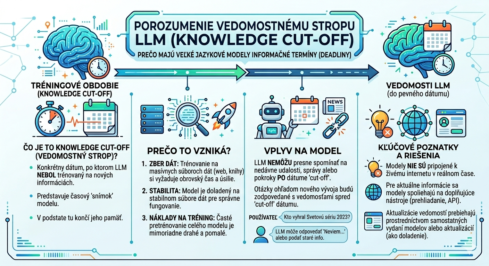

# Úvod do umelej inteligencie (AI)

## Autor

- Ján Bodnár
- vyštudované financie
- Unix administrátor, Java/Python vývojár
- školím základy Javy, Pythonu, dátovú analýzu a AI

## Školenie

- trvanie: 2 dni, od 9.00 do 15.00
- o 10.30 krátka 10-minútová prestávka
- 12.00 – 13.00 obedňajšia prestávka


## Definícia

*Umelá inteligencia (AI)* je oblasť informatiky, ktorá vytvára systémy schopné  
vykonávať úlohy, na ktoré by inak bola potrebná ľudská inteligencia – napríklad  
porozumieť jazyku, rozpoznať obrázok, zhrnúť dokument alebo navrhnúť riešenie problému.

Moderná AI sa väčšinou **učí z dát**. Namiesto toho, aby programátor presne určil  
každý krok, systém sám nájde vzory v príkladoch a tie potom použije na nové situácie.

> **Jednoducho povedané:** AI je počítačový program, ktorý sa vie učiť z dát a pomáhať  
> nám riešiť úlohy – od písania textov až po rozpoznávanie obrázkov.




| Klasický program | Strojové učenie |
|------------------|-----------------|
| Človek napíše pravidlá | Model sa pravidlá naučí z príkladov |
| Vstup: dáta + pravidlá → výstup | Vstup: dáta + správne odpovede → naučený model |
| Hodí sa na presne definované úlohy (účtovníctvo, výpočty) | Hodí sa na úlohy, ktoré sa ťažko popisujú pravidlami (reč, obraz, text) |
| Výsledok je predvídateľný | Výsledok je pravdepodobnostný – môže sa mýliť |


**Čo dnešné AI modely (najmä jazykové) charakterizuje:**

- obsahujú obrovské množstvo naučených znalostí z textov, kníh a webu
- zvládajú kognitívne úlohy: porozumieť, zhrnúť, preložiť, zdôvodniť, naplánovať
- pracujú s pravdepodobnosťou, nie s istotou – preto sa môžu mýliť


**Stručná história:**

- **1950:** Alan Turing navrhuje „Turingov test" a kladie otázku, či stroje môžu myslieť
- **1956:** Konferencia v Dartmouthe – vzniká pojem *artificial intelligence*
- **1970s – 1980s:** Expertné systémy – programy s ručne písanými pravidlami pre úzke oblasti
- **1990s – 2000s:** Strojové učenie – počítače sa učia z dát (1997 Deep Blue porazil Kasparova)
- **2012:** Prelom hlbokého učenia v rozpoznávaní obrázkov (sieť AlexNet)
- **2017:** Architektúra *Transformer* – základ dnešných jazykových modelov
- **2022:** ChatGPT sprístupňuje AI širokej verejnosti
- **2024+:** Multimodálne modely (text, obraz, zvuk, video), „premýšľajúce" modely a AI agenti

Podrobnejšie v časti [História AI](historia.md).


## Oblasti využitia

| Oblasť | Ako AI pomáha | Príklad nástroja |
|--------|---------------|------------------|
| ✍️ **Písanie** | Generuje nápady, píše texty, opravuje gramatiku a štýl | ChatGPT, Claude, Gemini |
| 🎨 **Obrázky** | Vytvára a upravuje grafiku podľa textového popisu | Midjourney, ChatGPT, Gemini |
| 🎵 **Hudba** | Skladá piesne vrátane spevu, generuje hudbu na pozadie | Suno, Udio |
| 🎬 **Video** | Generuje scény z textu alebo obrázka, pomáha so strihom | Veo, Sora, Runway, Kling |
| 🗣️ **Reč** | Prepis reči na text, syntéza hlasu, preklad v reálnom čase | Whisper, ElevenLabs |
| 💻 **Programovanie** | Navrhuje a píše kód, hľadá chyby, vysvetľuje funkcie | GitHub Copilot, Claude Code, Cursor |
| 🔎 **Vyhľadávanie** | Odpovedá na otázky so zdrojmi, robí rešerše | Perplexity, Deep Research |
| 🤖 **Robotika** | Umožňuje autonómne rozhodovanie strojov | výrobné roboty, drony, autonómne autá |


Moji študenti využívajú AI na:

- právnu analýzu zmlúv
- výučbu cudzích jazykov
- tvorbu reklamných materiálov
- hľadanie receptov
- profesionálny jazykový preklad
- tvorbu Python skriptov (aj ako neprogramátori)
- vyhľadanie a porovnanie výhodných cien Apple produktov
- sumarizáciu textov
- tvorbu prezentácií
- tvorbu poviedok a esejí
- tvorbu komiksu


## Učenie AI

### Strojové učenie v skratke

1. **Dáta** → AI dostane veľa príkladov (napr. fotky mačiek a psov)
2. **Tréning** → hľadá vzory a rozdiely medzi príkladmi
3. **Predikcia** → po natrénovaní vie zaradiť aj fotky, ktoré nikdy nevidela

**Tri hlavné typy učenia:**

- 🟢 **S učiteľom (supervised):** dáta sú označené (napr. „toto je mačka")
- 🔵 **Bez učiteľa (unsupervised):** AI sama hľadá skupiny a vzory v neoznačených dátach
- 🟡 **S posilňovaním (reinforcement):** AI sa učí metódou pokus – omyl a dostáva „odmeny" za správne rozhodnutia

> 💡 Jazykové modely kombinujú všetky tri prístupy: najprv sa učia predpovedať text z obrovského  
> množstva dát, potom sa dolaďujú na príkladoch dobrých odpovedí a nakoniec pomocou spätnej väzby  
> (tzv. RLHF – posilňovanie na základe hodnotenia od ľudí).

### Neurónové siete – inšpirácia mozgom



```
Vstup (dáta) → Skryté vrstvy (spracovanie) → Výstup (výsledok)
```

- sieť sa skladá z „neurónov" prepojených **váhami** (číslami, ktoré určujú silu prepojenia)
- počas tréningu sa váhy postupne upravujú, aby sieť robila čo najmenej chýb
- **hlboké učenie** = sieť s mnohými vrstvami → schopnosť zachytiť zložité vzory

> 🎯 **Zjednodušená metafora:** Predstavte si neurónovú sieť ako tím špecialistov, kde každý rieši  
> malú časť úlohy a spoločne dospejú k výsledku.

### Odporúčané video

- https://www.youtube.com/watch?v=FT5O2JyrvOk


## Veľké jazykové modely (LLM)

**LLM** (*Large Language Model*, napr. GPT, Claude, Gemini, Llama) sú AI modely trénované  
na obrovskom množstve textov – stovkách miliárd až desiatkach biliónov slov z webu, kníh,  
odborných článkov a zdrojového kódu. Vedia:

- rozumieť kontextu a odpovedať na otázky
- písať e-maily, články, kód
- prekladať a zhŕňať texty
- vysvetľovať zložité témy jednoducho
- analyzovať dokumenty, tabuľky a obrázky (multimodálne modely)

**Ako fungujú?**

- pri tréningu sa učia predpovedať, aký **token** (časť slova) má nasledovať po predchádzajúcom texte
- odpoveď generujú postupne, token po tokene
- väčší model (viac **parametrov**) zvyčajne zachytí jemnejšie súvislosti – rozhoduje však aj kvalita dát a spôsob tréningu
- nemyslia ako ľudia – generujú pravdepodobné pokračovanie textu, preto sa môžu mýliť

Podrobnejšie v častiach [LLM](llm.md) a [Fungovanie LLM](fungovanie-llm.md).


## Zdroje informácií a znalostí



*Ľadovec internetu – viditeľná časť (nad hladinou) predstavuje bežný obsah webu, ktorý ľudia denne navštevujú.
Pod hladinou sa skrýva oveľa rozsiahlejšia časť internetu: odborné databázy, vedecké archívy, fóra,
digitalizované knihy a ďalšie textové zdroje. Z veľkej časti týchto dát sa učia veľké jazykové modely (LLM).*


## Token – jednotka spracovania textu

V kontexte veľkých jazykových modelov (LLM) sú **tokeny** základnou stavebnou jednotkou textu.  
Predstavte si ich ako „slová", ktorým rozumie stroj, hoci sa nie vždy zhodujú s ľudským chápaním  
slova. Model nepracuje priamo s písmenami, ale s číselnými reprezentáciami týchto tokenov.

**Ako fungujú?**

Skôr než AI model text spracuje, rozdelí ho na menšie časti – tokeny.  
Tento proces sa nazýva **tokenizácia**. Jeden token môže predstavovať:

* celé krátke alebo časté slovo (napr. „stôl", „a"),
* časť dlhšieho slova (napr. „neur" + „ón" + „ová"),
* jednotlivý znak či interpunkciu (napr. „.", „!").

**Príklad tokenizácie:**

Veta: „Umelá inteligencia mení svet."  
môže byť modelom rozložená na tokeny približne takto:

```
["Um", "elá", " intel", "igen", "cia", " men", "í", " svet", "."]
```

Medzera sa zvyčajne stáva súčasťou nasledujúceho tokenu. Presné delenie závisí od konkrétneho modelu.  
Vyskúšať si to môžete napríklad v nástroji [OpenAI Tokenizer](https://platform.openai.com/tokenizer).

**Prečo sú tokeny dôležité?**

1. **Kontextové okno:** Modely majú limit na počet tokenov, s ktorými dokážu pracovať naraz  
   (vstupný prompt + história konverzácie + výstupná odpoveď). Tento limit určuje, koľko textu  
   model „vidí" v rámci jednej konverzácie alebo analýzy dokumentu.
2. **Náklady a rýchlosť:** Väčšina AI služieb (najmä API) účtuje cenu podľa počtu spracovaných tokenov.  
   Čím dlhší text, tým viac tokenov – a tým vyššia cena a dlhší čas generovania odpovede.
3. **Jazykové špecifiká:** Angličtina sa zvyčajne tokenizuje efektívnejšie (menej tokenov na slovo)  
   než slovenčina či čeština. Dôvodom je, že tokenizéry vznikajú prevažne na anglických textoch  
   a slovanské jazyky majú bohaté skloňovanie a diakritiku. Rovnaký obsah v slovenčine tak  
   spotrebuje viac tokenov.

> 📏 **Orientačne:** v angličtine 1 token ≈ ¾ slova (100 tokenov ≈ 75 slov). V slovenčine  
> pripadá na jedno slovo často 2 – 3 tokeny.

Pochopenie tokenov je kľúčové pre optimalizáciu promptov, odhadovanie nákladov a efektívnu prácu  
s AI nástrojmi. Viac v časti [Kontext](context.md).


## Knowledge Cut-off

**Knowledge cut-off** (hranica poznania) je dátum, po ktorý siahajú dáta, na ktorých bol  
AI model trénovaný. Predstavte si ho ako „uzávierku" vedomostí modelu – čo sa udialo po tomto  
dátume, model nepozná, pokiaľ nemá prístup k externým nástrojom, napríklad k vyhľadávaniu na webe.

AI modely sa neučia priebežne v reálnom čase. Ich trénovanie je náročný a nákladný proces, ktorý  
prebieha v konkrétnych cykloch:

1. **Zber dát:** model sa „kŕmi" obrovským množstvom textov z rôznych zdrojov.
2. **Tréning:** model sa učí vzory, súvislosti a jazykové štruktúry.
3. **Uzavretie:** po dokončení tréningu sa model „zmrazí" – jeho znalosti sa už nemenia,  
   kým nevyjde nová verzia.

> ℹ️ Medzi koncom zberu dát a vydaním modelu zvyčajne uplynie niekoľko mesiacov.  
> Model teda „nevie" ani o udalostiach z obdobia tesne pred svojím vydaním.

**Praktické dôsledky pre používateľov**

| Situácia | Čo sa môže stať | Ako tomu predísť |
|----------|-----------------|------------------|
| **Otázka na aktuálnu udalosť** | Model odpovie, že „nemá informácie", alebo uvedie zastarané údaje. | Zapnite **vyhľadávanie na webe** alebo overte informáciu v aktuálnych zdrojoch. |
| **Práca s najnovšími technológiami** | Model nemusí poznať verzie softvéru, ktoré vyšli po cut-off dátume. | Uveďte kontext v prompte alebo nahrajte dokumentáciu ako súbor. |
| **Štatistiky a dáta** | Čísla (napr. počet obyvateľov, ceny kryptomien) môžu byť historické, nie aktuálne. | Číselné údaje si vždy overte v aktuálnych zdrojoch. |
| **Vedecké objavy** | Štúdie a publikácie po dátume cut-off model nepozná. | Použite vyhľadávanie alebo akademické databázy. |



**Zhrnutie:**

> Knowledge cut-off nie je chyba modelu, ale jeho technická vlastnosť. Predstavte si AI ako veľmi  
> sčítaného študenta, ktorý má v hlave všetko, čo sa naučil do určitého dátumu, no na novšie udalosti  
> sa musí pozrieť do „učebnice" (webu) alebo sa opýtať vás. Vedieť, kde táto hranica je, vám pomôže  
> klásť lepšie otázky a kriticky vyhodnocovať odpovede.


## Chatboty – AI ako váš asistent

| Chatbot | Vývojár | Hlavné silné stránky a zameranie | Oficiálna stránka |
| :--- | :--- | :--- | :--- |
| **ChatGPT** | OpenAI | **Všestranný líder.** Silná multimodalita (obraz, hlasový režim v reálnom čase), generovanie obrázkov a vlastné GPT asistenty. | [chatgpt.com](https://chatgpt.com) |
| **Claude** | Anthropic | **Kvalita textu a práca s dokumentmi.** Prirodzený písaný prejav, dlhý kontext, výborný na písanie a programovanie. | [claude.ai](https://claude.ai) |
| **Gemini** | Google | **Ekosystém a analýza.** Prepojenie s Gmailom, Dokumentmi a Diskom, analýza dlhých videí a PDF. | [gemini.google.com](https://gemini.google.com) |
| **Copilot** | Microsoft | **Kancelárska produktivita.** Integrácia do Windows a Microsoft 365 (Word, Excel, PowerPoint, Outlook). | [copilot.microsoft.com](https://copilot.microsoft.com) |
| **Meta AI** | Meta | **Sociálna integrácia.** Asistent v Messengeri, WhatsAppe a Instagrame, postavený na modeloch Llama. | [meta.ai](https://www.meta.ai/) |
| **Perplexity** | Perplexity AI | **Inteligentné vyhľadávanie.** Odpovedá na otázky s priamymi odkazmi na zdroje. | [perplexity.ai](https://www.perplexity.ai) |
| **Grok** | xAI | **Aktuálne dianie.** Prístup k príspevkom na sieti X (Twitter) a neformálny štýl komunikácie. | [grok.com](https://grok.com) |
| **Mistral Le Chat** | Mistral AI | **Európska alternatíva.** Francúzska firma, dôraz na rýchlosť a nasadenie v súlade s pravidlami EÚ. | [chat.mistral.ai](https://chat.mistral.ai) |
| **DeepSeek** | DeepSeek | **Programovanie a matematika.** Výkonné otvorené modely s nízkou cenou. Pozor na ochranu dát (servery v Číne). | [chat.deepseek.com](https://chat.deepseek.com) |
| **Qwen** | Alibaba | **Otvorené modely.** Silný v technických úlohách a v mnohých svetových jazykoch. | [chat.qwen.ai](https://chat.qwen.ai) |
| **Kimi** | Moonshot AI | **Uvažovanie a agenti.** Silný v logických úlohách a spracovaní veľkého množstva textu naraz. | [kimi.com](https://www.kimi.com) |
| **Pi** | Inflection AI | **Konverzačný spoločník.** Navrhnutý na dlhé, priateľské rozhovory a reflexiu. | [pi.ai](https://pi.ai) |

> ⚠️ Ponuka chatbotov a ich schopnosti sa menia veľmi rýchlo – každých pár mesiacov vychádzajú nové verzie modelov.


### Ktorý z nich vyskúšať ako prvý?

* **Ak chcete univerzálneho pomocníka:** vyskúšajte **ChatGPT** alebo **Gemini**.
* **Ak píšete článok, správu alebo seminárnu prácu:** vyskúšajte **Claude**, jeho štýl pôsobí najmenej „umelo".
* **Ak robíte prieskum alebo hľadáte fakty so zdrojmi:** vyskúšajte **Perplexity**, ušetrí vám hodiny klikania po weboch.
* **Ak pracujete v Microsoft 365:** vyskúšajte **Copilot** priamo vo Worde či Exceli.
* **Ak programujete:** vyskúšajte **Claude**, **ChatGPT** alebo **DeepSeek**.

**Čo chatboty vedia:**

- odpovedať na otázky v prirodzenom jazyku
- pomáhať s brainstormingom a plánovaním
- vysvetľovať kód alebo odborné pojmy
- pamätať si kontext v rámci konverzácie (niektoré aj medzi konverzáciami pomocou funkcie *pamäť*)
- vyhľadávať na webe, čítať nahraté súbory a pracovať s obrázkami

**Čo (zatiaľ) nevedia:**

- ❌ nemajú skutočné „vedomie" ani emócie
- ❌ môžu sa mýliť alebo „vymýšľať" fakty (halucinácie)
- ❌ nemajú prístup k vašim súkromným dátam, kým im ho výslovne neumožníte (nahratím súboru, prepojením služby)
- ❌ bez vyhľadávania nepoznajú udalosti po svojom knowledge cut-off

> ⚠️ Kritické informácie si vždy overte z iného zdroja!

---

## Ako písať dobré prompty? (Návod pre začiatočníkov)

**Prompt** = inštrukcia alebo otázka, ktorú zadáte AI, aby vygenerovala odpoveď.

### 5 zlatých pravidiel

1. **Buďte konkrétni**  
   ❌ „Napíš niečo o marketingu."  
   ✅ „Napíš 3 odrážky o výhodách e-mail marketingu pre malé firmy."

2. **Dajte kontext**  
   ✅ „Vysvetli pojem ‚neurónová sieť' tak, aby tomu rozumel žiak 5. triedy."

3. **Priraďte rolu**  
   ✅ „Správaj sa ako skúsený UX dizajnér a navrhni 5 vylepšení pre túto stránku..."

4. **Špecifikujte formát**  
   ✅ „Odpoveď daj vo forme tabuľky so stĺpcami: Výhoda / Príklad / Riziko."

5. **Ukážte príklad (voliteľné)**  
   ✅ „Formátuj odpoveď takto: [príklad]"

### Šablóna dobrého promptu

```
[Rola] + [Úloha] + [Kontext] + [Formát] + [Obmedzenia]

Príklad:
"Správaj sa ako lektor AI školenia. Vysvetli začiatočníkovi, čo je prompt engineering.
Použi jednoduché príklady z bežného života. Odpoveď daj v 5 odrážkach, max. 2 vety na odrážku."
```

> 🔄 **Iterácia je kľúčová:** Ak prvá odpoveď nie je ideálna, upresnite prompt alebo požiadajte  
> o úpravu priamo v konverzácii („skráť to", „pridaj príklady", „napíš to formálnejšie").

Viac v časti [Prompt engineering](prompt-engineering.md).

---

## Praktické ukážky pre školenie

### Zhrnutie textu

```
Prompt: "Zhrň tento článok o klimatických zmenách do 3 hlavných bodov pre manažérov."
Výstup: Stručný prehľad bez technického žargónu.
```

**Využitie:** rýchle spracovanie dlhých reportov, e-mailov, článkov.

### Preklad s kontextom

```
Prompt: "Prelož tento technický popis do slovenčiny. Zachovaj odborné termíny,
ale vysvetli ich v zátvorke pre začiatočníkov."
```

**Výhoda oproti klasickým prekladačom:** AI chápe kontext a vie prispôsobiť štýl cieľovému čitateľovi.

### Extrakcia informácií

```
Prompt: "Z tohto životopisu vytiahni: meno, poslednú pozíciu a 3 kľúčové zručnosti.
Výstup daj ako JSON."
```

**Využitie:** automatizácia spracovania životopisov, faktúr, formulárov.

### Analýza sentimentu

```
Prompt: "Prečítaj týchto 10 recenzií a zhrň: Čo zákazníkom najviac chýba?
Aké slová sa opakujú v negatívnych hodnoteniach?"
```

**Využitie:** rýchly prehľad spätnej väzby bez manuálneho čítania.

---

## Bezpečnosť a etika – na čo myslieť

✅ **Dobré praktiky:**

- overujte fakty, najmä ak na odpovedi niečo závisí
- nezdieľajte citlivé osobné ani firemné dáta s verejnými chatbotmi (pozor na GDPR)
- skontrolujte nastavenia súkromia – niektoré služby môžu vaše konverzácie použiť na tréning
- buďte transparentní, ak obsah vytvorila AI
- rešpektujte autorské práva pri generovaní obrázkov a textov
- dodržiavajte firemné pravidlá pre používanie AI a európsky **AI Act**

❌ **Časté chyby začiatočníkov:**

- slepo dôverovať odpovediam bez kontroly
- očakávať, že AI „vie všetko" – má medzery v znalostiach a hranicu poznania
- používať AI na úlohy vyžadujúce ľudský úsudok (právne, zdravotné, finančné rozhodnutia) bez dohľadu odborníka

> **Záver:** AI je mocný nástroj, ale ako každý nástroj vyžaduje pochopenie,  
> zodpovednosť a kritické myslenie.


## Rýchly slovník pojmov

| Pojem | Vysvetlenie |
|-------|-------------|
| **AI / Umelá inteligencia** | Systémy, ktoré vykonávajú úlohy typicky vyžadujúce ľudskú inteligenciu |
| **Algoritmus** | Presný postup krokov na vyriešenie úlohy |
| **Dáta** | Informácie (text, obrázky, čísla...), z ktorých sa AI učí alebo ktoré spracúva |
| **Strojové učenie** | Prístup k AI, pri ktorom sa systém učí z dát namiesto explicitného programovania |
| **Neurónová sieť** | Výpočtový model inšpirovaný ľudským mozgom, skladá sa z prepojených „neurónov" |
| **Hlboké učenie** | Používanie neurónových sietí s mnohými vrstvami na riešenie zložitých úloh |
| **Tréning** | Proces, pri ktorom sa AI učí z príkladov a upravuje svoje váhy |
| **Parametre** | Číselné hodnoty (váhy) modelu naučené počas tréningu – veľké modely ich majú miliardy |
| **Overfitting / Pretrénovanie** | Keď sa model príliš prispôsobí trénovacím dátam a zle zovšeobecňuje na nové situácie |
| **LLM** | Veľký jazykový model – AI trénovaná na obrovskom množstve textov |
| **Token** | Základná jednotka textu pre AI (približne ¾ slova v angličtine, v slovenčine často kratšie úseky) |
| **Kontextové okno** | Maximálne množstvo textu (v tokenoch), s ktorým model dokáže naraz pracovať – prompt, história aj odpoveď |
| **Knowledge cut-off** | Dátum, po ktorý siahajú trénovacie dáta modelu |
| **Halucinácia** | Keď AI vygeneruje nesprávnu, ale presvedčivo znejúcu odpoveď |
| **Teplota (modelu)** | Nastavenie „kreativity" – vyššia hodnota = viac náhodnosti a originality, nižšia = presnejšie a konzervatívnejšie odpovede |
| **Prompt** | Inštrukcia alebo otázka, ktorú zadávate AI |
| **Prompt engineering** | Umenie formulovať vstupné inštrukcie tak, aby AI poskytla čo najlepšiu odpoveď |
| **Few-shot learning** | Schopnosť AI zvládnuť úlohu na základe niekoľkých príkladov uvedených priamo v prompte |
| **Fine-tuning / Doladenie** | Dodatočné trénovanie hotového modelu na špecifickú úlohu alebo dáta |
| **RAG (Retrieval-Augmented Generation)** | Technika, pri ktorej AI najskôr vyhľadá relevantné informácie v externom zdroji a až potom generuje odpoveď |
| **Multimodálny model** | Model, ktorý pracuje s viacerými typmi vstupov – text, obraz, zvuk, video |
| **AI agent** | Systém, ktorý pomocou AI samostatne plánuje a vykonáva viac krokov a používa nástroje (web, súbory, aplikácie) |


## Otázky a diskusia
