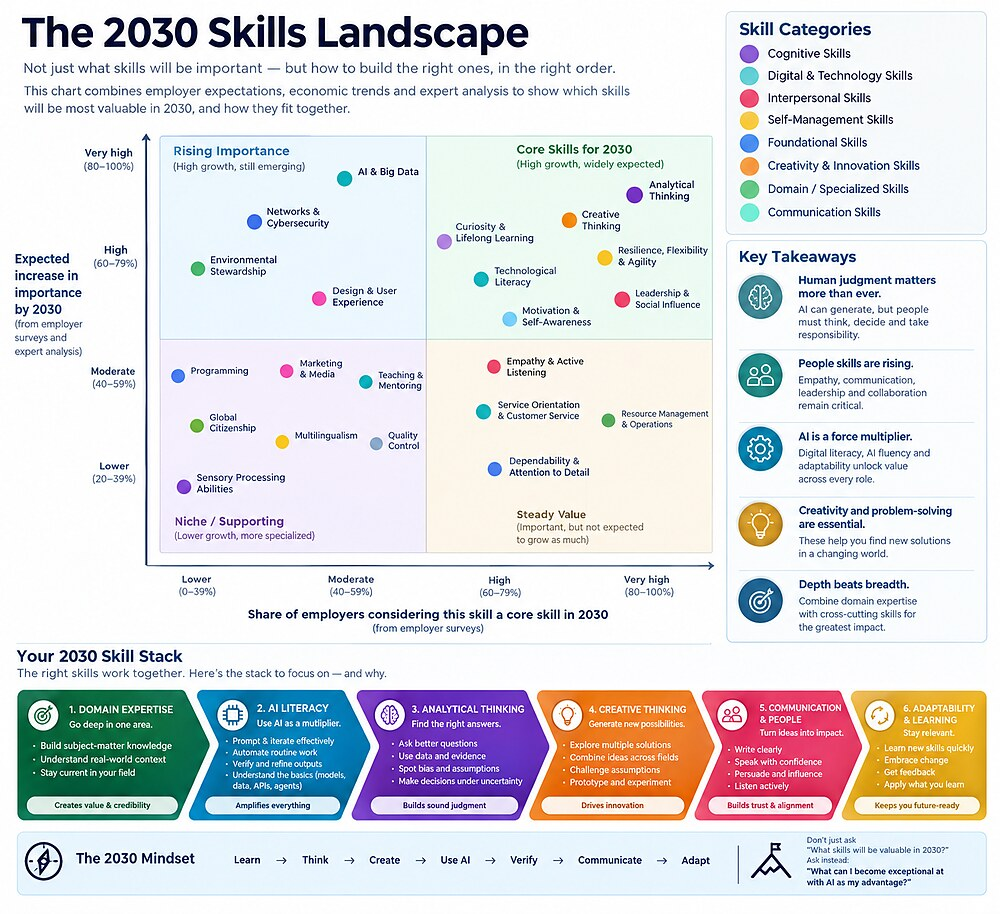
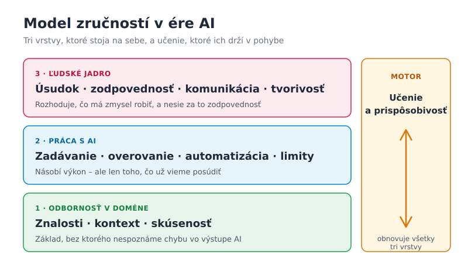

# Zručnosti v ére AI  

Prognózy o tom, ktoré zručnosti budú žiadané, sa objavujú každý rok.  
Väčšina z nich ponúka zoznam: analytické myslenie, tvorivosť, digitálna  
gramotnosť. Takýto zoznam je užitočný, ale nevysvetľuje to podstatné –  
*prečo* sa dopyt mení a *ako* spolu jednotlivé zručnosti súvisia.  

Táto kapitola sa preto nesnaží predpovedať budúcnosť. Snaží sa pochopiť  
mechanizmus: čo presne AI mení na práci a čo z toho vyplýva pre to,  
čo sa oplatí učiť.  

## Obsah  

- [Čo hovoria dáta](#čo-hovoria-dáta)  
- [AI mení úlohy, nie profesie](#ai-mení-úlohy-nie-profesie)  
- [Generovanie zlacnelo, overovanie nie](#generovanie-zlacnelo-overovanie-nie)  
- [Model zručností v troch vrstvách](#model-zručností-v-troch-vrstvách)  
- [Paradox učňa](#paradox-učňa)  
- [Čo stráca a čo získava na hodnote](#čo-stráca-a-čo-získava-na-hodnote)  
- [Ako k prognózam pristupovať](#ako-k-prognózam-pristupovať)  
- [Praktický plán](#praktický-plán)  
- [Otázky na diskusiu](#otázky-na-diskusiu)  
- [Zdroje](#zdroje)  

## Čo hovoria dáta  

Najcitovanejším zdrojom je správa Svetového ekonomického fóra  
*Future of Jobs Report 2025*, založená na prieskume medzi veľkými  
zamestnávateľmi v desiatkach krajín. Jej hlavné zistenia:  

- **Pracovné miesta sa skôr presúvajú, než miznú.** Do roku 2030 má  
  vzniknúť približne 170 miliónov nových pracovných miest a zaniknúť  
  92 miliónov. Čistý prírastok je teda okolo 78 miliónov.  
- **Zručnosti sa menia rýchlo.** Zamestnávatelia očakávajú, že takmer  
  40 % kľúčových zručností pracovníkov sa do roku 2030 zmení.  
- **Najrýchlejšie rastie dopyt po technických zručnostiach:** AI  
  a veľké dáta, siete a kybernetická bezpečnosť, technologická  
  gramotnosť.  
- **Najčastejšie uvádzanou kľúčovou zručnosťou je však analytické  
  myslenie.** Hneď za ním nasledujú odolnosť a flexibilita, vodcovstvo,  
  tvorivé myslenie a zvedavosť spojená s celoživotným učením.  

Podobné prieskumy sa často zhŕňajú do máp zručností. Nasledujúca  
infografika rozdeľuje zručnosti podľa dvoch kritérií: koľko  
zamestnávateľov ich považuje za kľúčové a ako rýchlo rastie ich význam.  

  

> **Poznámka k obrázku:** Infografika bola vytvorená pomocou AI a voľne  
> vychádza z prieskumov zamestnávateľov. Polohy bodov sú orientačné,  
> nie presné namerané hodnoty. Je dobrou ukážkou typickej prognózy –  
> ponúka prehľad *čo*, no menej vysvetľuje *prečo*.  

Na prvý pohľad je v dátach rozpor: najrýchlejšie rastú technické zručnosti,  
no najdôležitejšie zostávajú ľudské. V skutočnosti ide o dve strany  
tej istej zmeny, ako ukážu nasledujúce časti.  

## AI mení úlohy, nie profesie  

Profesia nie je jedna činnosť, ale zväzok mnohých úloh. Účtovník  
zapisuje doklady, ale aj vysvetľuje klientovi daňové dôsledky. Programátor  
píše kód, ale aj zisťuje, čo vlastne používateľ potrebuje.  

AI zvláda najmä úlohy, ktoré majú:  

- jasne definovaný vstup a výstup,  
- veľa príkladov v tréningových dátach,  
- výsledok, ktorý sa dá rýchlo skontrolovať.  

Takéto úlohy sa v profesii zmenšujú alebo úplne miznú. Ostávajú tie,  
ktoré vyžadujú kontext, zodpovednosť, vyjednávanie či rozhodovanie  
bez jasnej odpovede. Profesia preto väčšinou nezanikne – zmení sa jej  
obsah. Otázka „nahradí AI moju prácu?“ je preto menej užitočná ako  
otázka „ktoré časti mojej práce prevezme a čo zostane mne?“.  

## Generovanie zlacnelo, overovanie nie  

Pred nástupom generatívnej AI bolo drahé *vytvoriť* text, kód, analýzu  
či návrh. Dnes to stojí sekundy. Nezlacnelo však *overenie*, či je  
výsledok správny, úplný a vhodný na daný účel.  

Z toho vyplýva kľúčový záver tejto kapitoly:  

> **Úzkym hrdlom práce sa stáva posúdenie, nie tvorba.** Kto nedokáže  
> výstup AI posúdiť, nemôže ho zodpovedne použiť – a jeho práca sa  
> zredukuje na kopírovanie.  

Overovanie si pritom vyžaduje presne to, čo zamestnávatelia v prieskumoch  
uvádzajú na prvom mieste: odbornosť v danej oblasti a analytické  
myslenie. Preto rastie dopyt po AI zručnostiach *a zároveň* po ľudskom  
úsudku. Jedno bez druhého nefunguje.  

## Model zručností v troch vrstvách  

Zručnosti pre prácu s AI možno usporiadať do troch vrstiev, ktoré na sebe  
stoja. Celok udržiava v pohybe schopnosť učiť sa.  

  

### 1. Odbornosť v doméne  

Základom je hlboké porozumenie konkrétnej oblasti – medicíne, právu,  
účtovníctvu, programovaniu či pedagogike. Odbornosť umožňuje rozpoznať,  
kedy AI odpovedá správne a kedy len presvedčivo. Bez nej nemá na čom  
stáť ani jedna z vyšších vrstiev.  

### 2. Práca s AI  

Druhá vrstva je praktická zručnosť používať AI ako nástroj:  

- **Zadávanie:** jasne opísať úlohu, kontext a požadovaný výsledok.  
- **Overovanie:** kontrolovať fakty, výpočty, zdroje a logiku výstupu.  
- **Automatizácia:** rozpoznať, ktoré opakované úlohy sa oplatí  
  delegovať.  
- **Poznanie limitov:** vedieť, kde AI zlyháva – halucinácie, zastarané  
  údaje, skreslenia či chýbajúci kontext.  

Táto vrstva *násobí* výkon. Násobí však len to, čo už je v prvej vrstve:  
nula krát čokoľvek je stále nula.  

### 3. Ľudské jadro  

Najvyššia vrstva zahŕňa schopnosti, ktoré sa nedajú delegovať, pretože  
sú spojené s človekom ako nositeľom zodpovednosti:  

- **Úsudok:** rozhodnúť sa v neistote a s neúplnými informáciami.  
- **Zodpovednosť:** stáť si za výsledkom a niesť jeho dôsledky.  
- **Komunikácia:** porozumieť potrebám druhých, vysvetliť, presvedčiť.  
- **Tvorivosť:** položiť otázku, ktorú nikto nepoložil, a spojiť  
  myšlienky z rôznych oblastí.  

AI dokáže pri týchto činnostiach pomáhať, no nedokáže ich prevziať.  
Model nemôže niesť zodpovednosť voči pacientovi, klientovi či tímu.  

### Motor: učenie a prispôsobivosť  

Nástroje sa menia v priebehu mesiacov, nie rokov. Preto žiadna vrstva  
nie je hotová raz a navždy. Schopnosť rýchlo sa učiť a opúšťať zastarané  
postupy obnovuje všetky tri vrstvy.  

## Paradox učňa  

Model má slabé miesto. Odbornosť sa tradične budovala opakovaním  
jednoduchých úloh – junior písal rutinný kód, koncipient pripravoval  
štandardné zmluvy, analytik čistil dáta. Práve tieto úlohy dnes AI  
preberá ako prvé.  

Vzniká paradox: AI je najužitočnejšia pre expertov, no zároveň  
oberá začiatočníkov o cestu, ktorou sa expertmi stávajú.  

Potvrdzuje to aj randomizovaný experiment Shena a Tamkina z roku 2026.  
Programátori, ktorí sa učili novú knižnicu s pomocou AI, ju pochopili  
horšie a slabšie zvládali čítanie kódu a ladenie. Významne rýchlejší  
pritom v priemere neboli. Štúdia však ukázala aj východisko: tí, ktorí  
AI používali na vysvetľovanie a kladenie otázok, namiesto toho, aby jej  
celú úlohu odovzdali, si učenie zachovali.  

> **Praktický dôsledok:** Pri učení používajte AI ako tútora, nie ako  
> náhradníka. Nechajte si vysvetliť princíp, ale riešenie napíšte sami.  
> Pri bežnej práci, ktorú už ovládate, môžete delegovať viac.  

## Čo stráca a čo získava na hodnote  

Žiadna zručnosť sa nestáva bezcennou. Mení sa však jej podoba  
a vzácnosť:  

| Stráca na vzácnosti | Získava na hodnote |  
|---|---|  
| Písanie bežného kódu podľa zadania | Návrh systému a kontrola kódu |  
| Preklad štandardných textov | Preklad s kultúrnym a odborným kontextom |  
| Zhrnutie dokumentu | Posúdenie, čo je v dokumente podstatné |  
| Vyhľadanie informácie | Overenie, či je informácia pravdivá |  
| Šablónové texty a správy | Presvedčivá komunikácia s ľuďmi |  
| Odpoveď na dobre položenú otázku | Položenie správnej otázky |  

Spoločný vzorec: hodnota sa presúva od *vykonania* úlohy k jej  
*zadaniu, posúdeniu a zodpovednosti* za výsledok.  

## Ako k prognózam pristupovať  

Údaje o budúcich zručnostiach treba čítať kriticky:  

- **Ide o očakávania, nie merania.** Prieskumy zachytávajú, čo  
  zamestnávatelia *predpokladajú*. Podobné prognózy sa v minulosti často  
  mýlili v rýchlosti aj smere zmien.  
- **Hlas majú najmä veľké firmy.** Malé podniky, verejný sektor či  
  samostatne zárobkovo činné osoby sú zastúpené menej.  
- **Pojmy sú široké.** „Analytické myslenie“ znamená niečo iné pre  
  zdravotnú sestru a niečo iné pre dátového analytika.  
- **Technológia sa mení rýchlejšie ako prieskumy.** Správa vydaná  
  na začiatku roka nemusí zachytiť schopnosti modelov z jeho konca.  

Najbezpečnejšou stratégiou preto nie je stávka na konkrétnu „zručnosť  
budúcnosti“, ale budovanie všetkých troch vrstiev a schopnosti učiť sa.  

## Praktický plán  

1. **Rozložte svoju prácu na úlohy.** Napíšte si desať činností, ktoré  
   bežne robíte. Pri každej odhadnite, či ju AI zvládne dnes, čiastočne,  
   alebo vôbec.  
2. **Posilnite jadro.** Úlohy, ktoré AI nezvládne, ukazujú, kde je vaša  
   nenahraditeľná hodnota. Investujte do nich čas.  
3. **Delegujte s kontrolou.** Pri úlohách, ktoré AI zvládne, ju používajte  
   – ale vždy výstup overte. Zaznamenávajte si, kde sa mýlila.  
4. **Učte sa bez skratiek.** Pri novej téme najprv pochopte základy sami.  
   AI využite na otázky a vysvetlenia, nie na hotové riešenie.  
5. **Hovorte o výsledkoch.** Vysvetlite kolegovi alebo spolužiakovi, čo  
   ste urobili a prečo. Komunikácia sa zlepšuje len praxou.  
6. **Opakujte raz za štvrťrok.** Nástroje sa zmenia – a s nimi aj  
   hranica medzi tým, čo zvládne AI a čo vy.  

> **Zhrnutie:** AI nenahrádza odbornosť, ale zvyšuje jej cenu. Tvorba  
> zlacnela, posúdenie zostalo drahé. Najlepšie pripravení budú ľudia,  
> ktorí svoj odbor ovládajú do hĺbky, vedia AI efektívne používať aj  
> kontrolovať a nesú zodpovednosť za výsledok.  

## Otázky na diskusiu  

1. Ktoré úlohy vo vašom odbore AI zvláda už dnes a ktoré podľa vás  
   nezvládne ani v roku 2030? Prečo?  
2. Súhlasíte s tvrdením, že overovanie je novým úzkym hrdlom práce?  
   Uveďte príklad, kedy to neplatí.  
3. Ako by mali firmy a školy riešiť paradox učňa, aby začiatočníci  
   mali kde získavať skúsenosti?  
4. Prečo zamestnávatelia uvádzajú ako najdôležitejšie analytické  
   myslenie, hoci najrýchlejšie rastie dopyt po AI zručnostiach?  
5. V ktorej z troch vrstiev modelu máte najväčšiu medzeru a ako ju  
   môžete zmenšiť?  

## Zdroje  

- [World Economic Forum: The Future of Jobs Report 2025](https://www.weforum.org/publications/the-future-of-jobs-report-2025/)  
- [Shen, Tamkin (2026): experiment o vplyve AI na učenie programátorov](https://arxiv.org/abs/2601.20245)  
